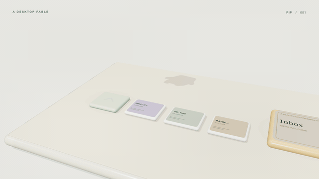

# A Little Order · 把想法变成下一步

一个原创 **5 秒、1920×1080、30fps** 的三维桌面动画样片。Pip 用身体触发界面：连跳三张便签，把三条想法送进 Inbox，展开一张计划卡，最后盖下完成印章。

这是给完整短片定方向的样片。当前仓库实现 5 秒版本；20 秒完整版为待评审分镜方案。



**[观看 5 秒高清有声样片](output/idea-to-plan-5s.mp4)** · **[关键帧总览](output/contact-sheet.jpg)** · **[完整分镜](docs/storyboard.md)** · **[制作流程](docs/workflow.md)**

## 提示词与分镜

| 文件 | 内容 |
| --- | --- |
| [参考片重构提示词](docs/reference-reconstruction-prompt.md) | 根据公开复盘和画面还原的制作需求；明确不是作者原始提示词 |
| [原创样片完整提示词](docs/sample-prompt.md) | 角色、美术、镜头、节奏、技术约定和验收标准 |
| [5 秒与拟议 20 秒分镜](docs/storyboard.md) | 时间、动作、因果关系、镜头、声音与读图停留 |
| [完整制作流程](docs/workflow.md) | 安装、建模、时间驱动、合成、检查、修改与发布 |
| [原创声音说明](docs/audio-notes.md) | 数学合成音轨、事件时间和响度检查 |

## 快速复现

需要 Node.js 20+、Python 3.10+，以及 Chrome 或 Playwright Chromium。首次安装需要联网；安装好依赖后可以本地渲染。

```bash
git clone https://github.com/itslezhi/idea-to-plan-film.git
cd idea-to-plan-film
npm ci
python3 -m venv .venv
source .venv/bin/activate
python -m pip install -r requirements.txt
npx playwright install chromium
python scripts/audio.py
npm run dev
```

打开终端打印的本机预览地址。点击 **Replay with sound** 从头播放并开启声音。声音文件由脚本生成，未将原参考片配乐带入项目。

```bash
npm run check    # 浏览器错误、关键时刻入镜和任意跳时的一致性
npm run stills   # 八张关键帧与 output/contact-sheet.jpg
npm run render   # 默认 150 帧、4 次快门采样、H.264/AAC
```

成片位于 `output/idea-to-plan-5s.mp4`。`FFMPEG=/path/to/ffmpeg` 和 `CHROME_PATH=/path/to/chrome` 可覆盖自动探测。虚拟环境激活后运行命令即可使用正确的 Python 依赖。

## 这 5 秒里发生了什么

| 时间 | 画面 |
| --- | --- |
| 0–0.5s | Pip 从上方落到启动键，脚下回弹 |
| 0.5–2.0s | 连跳三张想法便签；落地才触发归档 |
| 2.0–3.0s | Inbox 原地展开为计划卡，镜头连续升高 |
| 3.0–4.0s | 三条下一步依次变清晰、勾选 |
| 4.0–4.5s | Pip 跳向印章区，4.15s 接触盖章，再让开印记 |
| 4.5–5.0s | 保留完整计划卡、角色和完成印章供观看 |

## 工程结构

```text
index.html              页面、字体与片名排版
src/film.js             原创角色、三维布景、材质、景深与所有时间状态
scripts/audio.py        固定随机种子的原创立体声音轨
scripts/serve.mjs       本地预览服务器
scripts/render.mjs      浏览器逐帧拍摄与 FFmpeg 编码
scripts/composite.py    线性光快门采样合成与关键帧联系表
scripts/check.mjs       确定性、资源与入镜检查
docs/                   提示词、分镜与完整流程
```

入口 `window.__seek(t)` 设置任意时刻的完整画面；`window.__ready` 等待字体与场景就绪；`window.__meta` 给出时长与帧率。普通网页预览按真实时间播放，渲染模式按绝对时间逐帧求值。没有录屏后手工剪辑的步骤。

这版角色直接用 Three.js 程序化建模。后续若要复杂造型，可将角色替换成 Blender 导出的 GLB，保留同一时间轴与渲染流程。

## 来源与许可

本项目的代码、原创角色、界面和合成声音采用 **MIT**。详见 [LICENSE](LICENSE) 与 [CREDITS.md](CREDITS.md)。

参考研究来自 [feitangyuan/onetake 的 Clawd desktop 案例](https://github.com/feitangyuan/onetake/tree/main/cases/clawd-desktop-19s)。本仓库独立实现，未复制其代码、模型、品牌图标或配乐，也不依赖安装 onetake。
