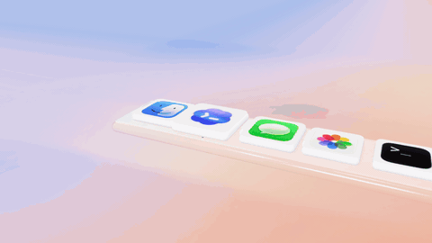

# Codex · Glass Desktop（5 秒修订样片）

这版依据反馈恢复参考视频的 macOS 软件桌面语言：真实应用图标、Dock 放大、透射玻璃窗口和三色窗控；角色改为带有白色 `>_` 的蓝紫 Codex 云形。



[高清有声 MP4](output/codex-glass-5s.mp4) · [分镜图](output/contact-sheet.jpg) · [完整提示词](docs/prompt.md) · [逐秒分镜](docs/storyboard.md) · [素材来源](docs/assets.md)

## 复现

在仓库根目录安装原有依赖。Node.js 20+、Python 3.10+、Chrome 或 Playwright Chromium；FFmpeg 由 `imageio-ffmpeg` 自动提供。

```bash
npm ci
python3 -m venv .venv
source .venv/bin/activate
python -m pip install -r requirements.txt
npx playwright install chromium
python variants/codex-glass/scripts/audio.py
npm run dev
```

打开 `http://127.0.0.1:4173/variants/codex-glass/`，点击 Replay with sound 开启声音。可用 `?t=2.4` 定位到指定时间。

```bash
npm run check:codex
npm run stills:codex
npm run render:codex
```

导出到 `variants/codex-glass/output/codex-glass-5s.mp4`，默认 1920×1080、30fps、150 帧、180° 快门、每帧 4 次时间采样。通过 `--workers 2` 可降低并行数。旧版入口与输出保留不变。

## 制作顺序

1. 从本机原生 `.icns` 抽取应用 PNG；保持真实图标，在运行时把透明边缘正确合成到圆角图标牌上。
2. 从 Codex 蓝紫云形提取 256 点轮廓，挤出成三维几何；原生正面图案与轮廓使用同一 UV 坐标。为其添加蓝色小四肢。
3. 绘制桃蓝渐变桌面，建立透射 Dock、图标和窗口；窗口正面的 UI 保持背景透明度，让壁纸与图标通过玻璃可见。
4. 用绝对时间驱动跳跃、压缩、Dock 放大、窗口弹出和输入；角色通过图标或窗口局部锚点跟随承载物。
5. 用物理材质、环境反射、景深、抗锯齿及时间采样完成质感；避免把角色或窗控重复捕捉进透射背景形成重影。
6. 按同一接触时间合成原创声音；先检查关键帧与跳跃顶点，再逐帧渲染和编码。

## 5 秒结构

| 时间 | 动作 |
| --- | --- |
| 0–0.5s | Codex 云形角色落到自身应用图标，Dock 放大 |
| 0.5–1.65s | 经过 Messages、Photos，落到 Terminal |
| 1.65–2.65s | Terminal 图标回弹，玻璃窗口从图标处展开 |
| 2.65–3.65s | 角色沿输入行跳动，输入 `make something delightful` 并提交 |
| 3.65–5s | 返回 `Ready to build.`，角色让开文字，通知浮出 |

## 许可范围

原创代码、动画编排和合成声音适用仓库 MIT 许可证。Apple/OpenAI 图标与 Codex 派生轮廓单独列明，不纳入 MIT 授权；不表示品牌方参与或背书。角色是本项目基于 Codex 图标制作的动画演绎。
